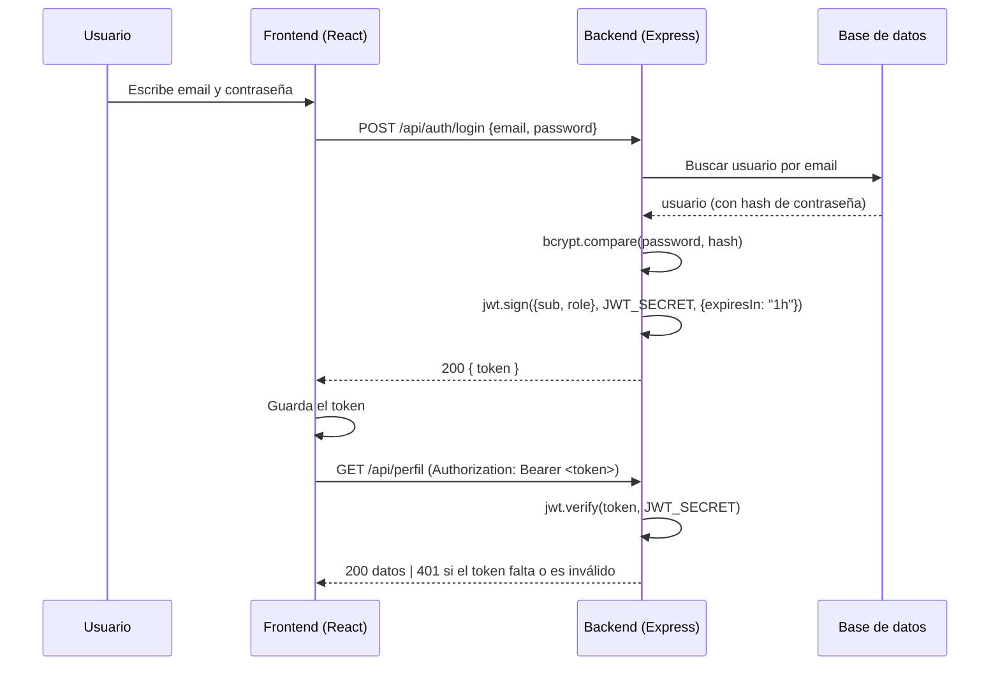

# Semana 15 — Evaluación: Seguridad, Integración, Pruebas y Despliegue

> Stack de referencia: **backend Node.js + Express** (API REST), **frontend React** (Vite), base de datos PostgreSQL.
> Librerías: `jsonwebtoken`, `bcrypt`, `cors`, `jest`, `supertest`.

Archivos de esta carpeta:

| Archivo | Contenido |
|---|---|
| `README.md` | Respuestas a los Problemas 1, 2 y 3 + requisito en inglés |
| `Dockerfile` | Imagen del backend (Problema 3) |
| `.dockerignore` | Archivos que no entran a la imagen |
| `.env.example` | Plantilla de variables de entorno (sin valores reales) |

---

## Problema 1 — Seguridad: login con JWT (1.5)

### 1.1 Flujo general



Un JWT tiene tres partes separadas por puntos: `header.payload.firma`.
El payload **no está cifrado** (solo codificado en Base64), por eso nunca se guarda la contraseña ni datos sensibles en él; solo el `id` del usuario (`sub`), su `role` y la expiración (`exp`). La **firma** (HMAC con `JWT_SECRET`) es lo que impide que alguien modifique el token sin que el backend lo detecte.

### 1.2 Emisión del token (backend)

```js
// routes/auth.js
const bcrypt = require("bcrypt");
const jwt = require("jsonwebtoken");

router.post("/login", async (req, res) => {
  const { email, password } = req.body;

  const user = await User.findByEmail(email);
  // Mismo mensaje para "no existe" y "clave incorrecta": no revelamos qué falló
  if (!user || !(await bcrypt.compare(password, user.passwordHash))) {
    return res.status(401).json({ error: "Credenciales inválidas" });
  }

  const token = jwt.sign(
    { sub: user.id, role: user.role },         // payload mínimo
    process.env.JWT_SECRET,                    // secreto en variable de entorno
    { expiresIn: process.env.JWT_EXPIRES_IN || "1h" }
  );

  res.json({ token });
});
```

Puntos de seguridad: las contraseñas se guardan con **hash bcrypt** (nunca en texto plano), el token **expira**, el secreto **no está en el código** y en producción todo viaja por **HTTPS**.

### 1.3 ¿Dónde lo guarda el frontend?

| Opción | Ventaja | Riesgo |
|---|---|---|
| `localStorage` | Simple, sobrevive a recargar la página | Si hay XSS, un script malicioso puede leer el token |
| Memoria (estado de React) | No lo puede leer un script persistente | Se pierde al recargar |
| Cookie `HttpOnly; Secure; SameSite=Strict` | JavaScript no puede leerla (protege contra XSS) | Requiere protección CSRF y configurar CORS con credenciales |

**Decisión para este proyecto:** `localStorage` con token de vida corta (1 h), escapando siempre el contenido que se renderiza (React lo hace por defecto) para reducir XSS. En un sistema en producción con datos sensibles se recomienda la cookie `HttpOnly`.

```js
// frontend: después del login
const res = await fetch(`${API_URL}/api/auth/login`, {
  method: "POST",
  headers: { "Content-Type": "application/json" },
  body: JSON.stringify({ email, password }),
});
if (!res.ok) throw new Error("Credenciales inválidas");
const { token } = await res.json();
localStorage.setItem("token", token);

// logout
localStorage.removeItem("token");
```

### 1.4 Cómo protege el backend un endpoint

Dos middlewares: uno **autentica** (¿el token es válido?) y otro **autoriza** (¿tu rol puede hacer esto?).

```js
// middleware/auth.js
const jwt = require("jsonwebtoken");

// AUTENTICACIÓN: ¿quién eres?
function verifyToken(req, res, next) {
  const header = req.headers.authorization || "";
  const [scheme, token] = header.split(" ");

  if (scheme !== "Bearer" || !token) {
    return res.status(401).json({ error: "Token requerido" });
  }
  try {
    req.user = jwt.verify(token, process.env.JWT_SECRET); // valida firma y exp
    next();
  } catch {
    return res.status(401).json({ error: "Token inválido o expirado" });
  }
}

// AUTORIZACIÓN: ¿qué puedes hacer?
function authorize(...rolesPermitidos) {
  return (req, res, next) => {
    if (!rolesPermitidos.includes(req.user.role)) {
      return res.status(403).json({ error: "No tienes permiso" });
    }
    next();
  };
}

module.exports = { verifyToken, authorize };
```

```js
// uso en las rutas
app.get("/api/perfil", verifyToken, perfilController);                     // cualquier usuario logueado
app.delete("/api/usuarios/:id", verifyToken, authorize("admin"), borrar);  // solo admin
```

### 1.5 Autenticación vs. autorización

| | Autenticación | Autorización |
|---|---|---|
| Pregunta | ¿Quién eres? | ¿Qué tienes permitido hacer? |
| Cuándo | Primero (login / verificar token) | Después de autenticar |
| En el código | `bcrypt.compare` + `jwt.sign` en el login; `verifyToken` en cada petición | `authorize("admin")`, revisar `req.user.role` o si el recurso es del usuario |
| Error HTTP | **401 Unauthorized** (no sé quién eres) | **403 Forbidden** (sé quién eres, pero no puedes) |

### 1.6 English requirement

**Authentication** is the process of verifying *who* a user is, for example by checking their email and password and then issuing a signed JWT that proves their identity on later requests. **Authorization** happens after authentication and decides *what* that verified user is allowed to do, such as allowing only users with the `admin` role to delete records. In short, a failed authentication returns **401 Unauthorized**, while an authenticated user without enough permissions receives **403 Forbidden**.

---

## Problema 2 — Integración y pruebas (2.0)

### 2.1 El frontend consume un endpoint protegido

Un cliente centralizado agrega el token a todas las peticiones y traduce los errores HTTP:

```js
// src/api/client.js
const API_URL = import.meta.env.VITE_API_URL; // p. ej. http://localhost:3000

export async function apiFetch(path, options = {}) {
  const token = localStorage.getItem("token");

  const res = await fetch(`${API_URL}${path}`, {
    ...options,
    headers: {
      "Content-Type": "application/json",
      ...(token && { Authorization: `Bearer ${token}` }),
      ...options.headers,
    },
  });

  if (res.status === 401) {                 // token vencido o inválido
    localStorage.removeItem("token");
    window.location.href = "/login";
    throw new Error("Tu sesión expiró. Inicia sesión de nuevo.");
  }
  if (res.status === 403) throw new Error("No tienes permiso para ver esto.");
  if (!res.ok) throw new Error(`Error del servidor (${res.status})`);

  return res.json();
}
```

El componente maneja los tres estados: **cargando**, **error** y **datos**:

```jsx
// src/pages/Perfil.jsx
import { useEffect, useState } from "react";
import { apiFetch } from "../api/client";

export default function Perfil() {
  const [data, setData] = useState(null);
  const [loading, setLoading] = useState(true);
  const [error, setError] = useState(null);

  useEffect(() => {
    apiFetch("/api/perfil")
      .then(setData)
      .catch((err) => setError(err.message))   // incluye fallos de red
      .finally(() => setLoading(false));
  }, []);

  if (loading) return <p>Cargando...</p>;
  if (error) return <p role="alert">⚠️ {error}</p>;
  return <h2>Hola, {data.nombre}</h2>;
}
```

### 2.2 Cómo resolver CORS

**El problema:** el frontend corre en `http://localhost:5173` y el backend en `http://localhost:3000`. Son orígenes distintos (cambia el puerto), así que el navegador bloquea la respuesta si el backend no lo autoriza. Además, como enviamos el encabezado `Authorization`, el navegador hace primero una petición **preflight `OPTIONS`** que el backend debe responder.

**Solución en el backend** con el middleware `cors` y una lista blanca leída de variables de entorno:

```js
// server.js
const cors = require("cors");

const allowedOrigins = process.env.CORS_ORIGIN.split(","); // "http://localhost:5173,https://miapp.com"

app.use(cors({
  origin: (origin, cb) => {
    // permite herramientas sin origen (curl, Postman) y los orígenes de la lista
    if (!origin || allowedOrigins.includes(origin)) return cb(null, true);
    cb(new Error("Origen no permitido por CORS"));
  },
  methods: ["GET", "POST", "PUT", "DELETE"],
  allowedHeaders: ["Content-Type", "Authorization"],
  credentials: true,   // solo necesario si se usan cookies
}));
```

Buenas prácticas:
- **No usar `origin: "*"`** en producción (y no se permite junto con `credentials: true`).
- CORS se configura **en el servidor**; no se "arregla" desde el frontend.
- Alternativa en desarrollo: proxy de Vite (`server.proxy: { "/api": "http://localhost:3000" }`), así el navegador ve un solo origen.
- Alternativa en producción: servir frontend y API detrás del mismo dominio con un reverse proxy (Nginx), lo que elimina CORS.

### 2.3 Prueba unitaria — middleware `verifyToken`

**Qué verifica:** la lógica de autenticación **aislada**, sin servidor ni base de datos: que un token válido deja pasar la petición, y que un token ausente, alterado o expirado responde 401.

```js
// tests/unit/verifyToken.test.js
const jwt = require("jsonwebtoken");
const { verifyToken } = require("../../src/middleware/auth");

process.env.JWT_SECRET = "secreto-de-prueba";

function mockRes() {
  const res = {};
  res.status = jest.fn().mockReturnValue(res);
  res.json = jest.fn().mockReturnValue(res);
  return res;
}

describe("verifyToken", () => {
  test("token válido: llama a next() y agrega req.user", () => {
    const token = jwt.sign({ sub: 1, role: "user" }, process.env.JWT_SECRET);
    const req = { headers: { authorization: `Bearer ${token}` } };
    const next = jest.fn();

    verifyToken(req, mockRes(), next);

    expect(next).toHaveBeenCalled();
    expect(req.user.sub).toBe(1);
  });

  test("sin token: responde 401 y no llama a next()", () => {
    const res = mockRes();
    const next = jest.fn();

    verifyToken({ headers: {} }, res, next);

    expect(res.status).toHaveBeenCalledWith(401);
    expect(next).not.toHaveBeenCalled();
  });

  test("token expirado: responde 401", () => {
    const token = jwt.sign({ sub: 1 }, process.env.JWT_SECRET, { expiresIn: -10 });
    const res = mockRes();

    verifyToken({ headers: { authorization: `Bearer ${token}` } }, res, jest.fn());

    expect(res.status).toHaveBeenCalledWith(401);
  });

  test("token firmado con otro secreto: responde 401", () => {
    const token = jwt.sign({ sub: 1 }, "secreto-falso");
    const res = mockRes();

    verifyToken({ headers: { authorization: `Bearer ${token}` } }, res, jest.fn());

    expect(res.status).toHaveBeenCalledWith(401);
  });
});
```

### 2.4 Prueba de integración — login + endpoint protegido

**Qué verifica:** que las piezas funcionan **juntas** a través de HTTP real (rutas + middlewares + controlador + base de datos de prueba): que el login devuelve un token, que ese token abre el endpoint protegido, y que los casos sin token (401) o sin permiso (403) se rechazan.

```js
// tests/integration/auth.test.js
const request = require("supertest");
const app = require("../../src/app");            // app de Express sin app.listen()
const { resetDb, seedUsers } = require("../helpers/db");

beforeAll(async () => {
  await resetDb();                                // BD de pruebas (DATABASE_URL de test)
  await seedUsers([
    { email: "ana@test.com",  password: "Clave123*", role: "user"  },
    { email: "root@test.com", password: "Admin123*", role: "admin" },
  ]);
});

async function login(email, password) {
  const res = await request(app).post("/api/auth/login").send({ email, password });
  return res.body.token;
}

describe("Flujo de autenticación", () => {
  test("login correcto devuelve un token", async () => {
    const res = await request(app)
      .post("/api/auth/login")
      .send({ email: "ana@test.com", password: "Clave123*" });

    expect(res.status).toBe(200);
    expect(res.body.token).toBeDefined();
  });

  test("login con contraseña incorrecta → 401", async () => {
    const res = await request(app)
      .post("/api/auth/login")
      .send({ email: "ana@test.com", password: "mala" });

    expect(res.status).toBe(401);
  });

  test("GET /api/perfil con token → 200 y datos del usuario", async () => {
    const token = await login("ana@test.com", "Clave123*");
    const res = await request(app)
      .get("/api/perfil")
      .set("Authorization", `Bearer ${token}`);

    expect(res.status).toBe(200);
    expect(res.body.email).toBe("ana@test.com");
  });

  test("GET /api/perfil sin token → 401", async () => {
    const res = await request(app).get("/api/perfil");
    expect(res.status).toBe(401);
  });

  test("usuario normal en ruta de admin → 403", async () => {
    const token = await login("ana@test.com", "Clave123*");
    const res = await request(app)
      .delete("/api/usuarios/2")
      .set("Authorization", `Bearer ${token}`);

    expect(res.status).toBe(403);
  });
});
```

| | Prueba unitaria | Prueba de integración |
|---|---|---|
| Alcance | Una función (`verifyToken`) | Login → token → ruta protegida |
| Dependencias | Ninguna (mocks de `req`, `res`, `next`) | App Express + BD de pruebas |
| Velocidad | Milisegundos | Más lenta |
| Detecta | Errores de lógica del middleware | Errores al conectar rutas, middlewares, BD y configuración |

Ejecución: `npm test` (con `"test": "jest"` en `package.json`).

---

## Problema 3 — Contenedores y despliegue (1.5)

### 3.1 Dockerfile

El archivo completo está en [`Dockerfile`](./Dockerfile). Resumen de cada paso:

| Instrucción | Por qué |
|---|---|
| `FROM node:20-alpine` | Imagen base oficial y liviana |
| `WORKDIR /app` | Carpeta de trabajo dentro del contenedor |
| `COPY package*.json` + `npm ci --omit=dev` | Instala solo dependencias de producción; al copiar primero el `package.json`, Docker reutiliza esta capa en caché si el código cambia pero las dependencias no |
| `COPY src ./src` | Copia el código fuente |
| `ENV NODE_ENV=production` | Modo producción de Express |
| `USER node` | No ejecuta como root (seguridad) |
| `EXPOSE 3000` | Documenta el puerto de la API |
| `HEALTHCHECK` | Docker sabe si la API responde |
| `CMD ["node", "src/server.js"]` | Comando que arranca el servidor |

El `.dockerignore` evita copiar `node_modules`, `.env`, `.git` y pruebas a la imagen (imagen más pequeña y **sin secretos dentro**).

### 3.2 Despliegue local

```bash
# 1. Crear el archivo de variables a partir de la plantilla y llenarlo
cp .env.example .env

# 2. Construir la imagen
docker build -t mi-backend:1.0 .

# 3. Ejecutar el contenedor pasando las variables de entorno
docker run -d --name api -p 3000:3000 --env-file .env mi-backend:1.0

# 4. Verificar
docker ps
docker logs api
curl http://localhost:3000/health
```

Con base de datos incluida, usando `docker-compose.yml`:

```yaml
services:
  api:
    build: .
    ports: ["3000:3000"]
    env_file: .env
    depends_on: [db]
  db:
    image: postgres:16-alpine
    environment:
      POSTGRES_USER: ${DB_USER}
      POSTGRES_PASSWORD: ${DB_PASSWORD}
      POSTGRES_DB: ${DB_NAME}
    volumes: [pgdata:/var/lib/postgresql/data]
volumes:
  pgdata:
```

`docker compose up -d --build` levanta API y base de datos. Dentro de la red de Compose el host de la BD es `db`, por eso `DATABASE_URL=postgres://usuario:clave@db:5432/mi_app`.

### 3.3 Despliegue en la nube (ej. Render / Railway / Azure Container Apps)

1. **Subir la imagen a un registro:**
   ```bash
   docker tag mi-backend:1.0 ghcr.io/<usuario>/mi-backend:1.0
   docker push ghcr.io/<usuario>/mi-backend:1.0
   ```
   (o conectar directamente el repositorio de GitHub y que la plataforma construya el `Dockerfile`).
2. **Crear el servicio** en la plataforma apuntando a la imagen y al puerto 3000.
3. **Crear la base de datos administrada** (PostgreSQL) y copiar su URL de conexión.
4. **Configurar las variables de entorno** en el panel de la plataforma (no en el repo).
5. **Desplegar** y verificar `https://<mi-servicio>/health`. La plataforma entrega HTTPS, necesario para que el JWT no viaje en texto plano.
6. Actualizar `CORS_ORIGIN` con la URL real del frontend y `VITE_API_URL` del frontend con la URL del backend.
7. (Opcional) Automatizar con GitHub Actions: en cada `push` a `main` → `npm test` → `docker build` → `docker push` → redeploy.

### 3.4 Variables de entorno

Plantilla en [`.env.example`](./.env.example):

| Variable | Ejemplo | Por qué va en variable de entorno |
|---|---|---|
| `PORT` | `3000` | Cada plataforma asigna su propio puerto |
| `NODE_ENV` | `production` | Cambia el comportamiento (logs, errores detallados) según el entorno |
| `DATABASE_URL` | `postgres://user:pass@db:5432/mi_app` | Contiene usuario y **contraseña** de la BD; distinta en local, pruebas y producción |
| `JWT_SECRET` | cadena aleatoria larga | **Secreto crítico**: con él cualquiera puede falsificar tokens válidos |
| `JWT_EXPIRES_IN` | `1h` | Ajustar la duración de sesión sin tocar código |
| `CORS_ORIGIN` | `https://miapp.com` | El dominio del frontend cambia entre entornos |

**Razones:**
- **Seguridad:** los secretos (`JWT_SECRET`, credenciales de BD) nunca se suben a GitHub ni quedan dentro de la imagen Docker. `.env` va en `.gitignore`; solo se sube `.env.example` sin valores reales.
- **Misma imagen, varios entornos:** la imagen se construye una vez y se configura distinto en local, pruebas y producción (principio *Config* de la metodología Twelve-Factor App).
- **Rotación sin recompilar:** si se filtra un secreto, se cambia la variable y se reinicia el servicio, sin reconstruir la imagen.

Para generar un `JWT_SECRET` seguro:
```bash
node -e "console.log(require('crypto').randomBytes(64).toString('hex'))"
```
